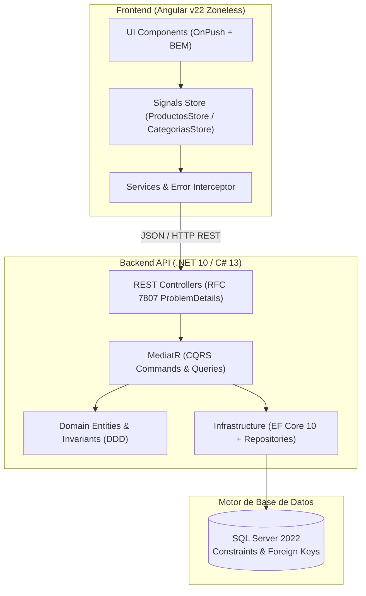

# Gestor de Inventario Agaval — Solución Full Stack Retail

[](https://github.com/JosephDavid005/Aplicacion_Gestion_de_Productos_Agaval)
[](https://github.com/JosephDavid005/Aplicacion_Gestion_de_Productos_Agaval)
[](https://github.com/JosephDavid005/Aplicacion_Gestion_de_Productos_Agaval)
[](https://github.com/JosephDavid005/Aplicacion_Gestion_de_Productos_Agaval)
[](https://github.com/JosephDavid005/Aplicacion_Gestion_de_Productos_Agaval)

Sistema empresarial de control, administración, auditoría de existencias (Kardex) y monitoreo de productos de retail para **Agaval**. Desarrollado con los más altos estándares de ingeniería de software: Clean Architecture (.NET 10, C# 13, MediatR CQRS), Frontend reactivo desacoplado (Angular v22 Zoneless con Signals y OnPush), y orquestación integral en contenedores Docker sin dependencia de runtimes en el host.

---

## 🏛️ Diagrama de Arquitectura del Sistema



---

## 🚀 Tecnologías y Patrones Aplicados

### Backend (.NET 10 & C# 13)
* **Clean Architecture en 4 capas:** `Domain`, `Application`, `Infrastructure`, `Api`.
* **CQRS con MediatR 12.x:** Separación estricta entre operaciones de mutación (Commands) y consultas de lectura (Queries).
* **Domain-Driven Design (DDD):** Invariantes encapsuladas en entidades ricas (`Producto`, `Categoria`, `MovimientoInventario`), control de stock no negativo y tipos fuertemente tipados.
* **Persistencia Robusta:** Entity Framework Core 10 con migraciones automáticas, claves foráneas e índices de unicidad.
* **Manejo Centralizado de Errores:** Middleware global que emite respuestas estándar RFC 7807 (`ProblemDetails`).
* **Documentación Interactiva:** Swagger / OpenAPI disponible en `/swagger`.

### Frontend (Angular v22 Zoneless)
* **Zoneless Change Detection:** Reactividad de máxima performance vía `provideZonelessChangeDetection()` sin la sobrecarga de `zone.js`.
* **Signals & OnPush:** Estado gestionado con `signal()`, `computed()` y `effect()`, garantizando renderizado granular y predecible.
* **Angular Material & SCSS BEM:** Componentes estandarizados (`mat-table`, `mat-sort`, `mat-paginator`, `mat-dialog`, `mat-select`), sin uso de `::ng-deep` ni malas prácticas.
* **Diseño Minimalista & UX Heurística:** Paleta de diseño basada en tokens CSS, iconografía nítida con Material Icons, tipografía *Plus Jakarta Sans* y componentes ergonómicos.
* **Bun Runtime:** Servidor SPA ultrarrápido y gestión eficiente de scripts.

### DevOps y Portabilidad
* **100% Contenedores Docker:** Cero instalación de SDKs o herramientas en el host. La compilación, ejecución de tests y servidor corren bajo Docker Compose.

---

## 🎯 Cumplimiento de Requerimientos Funcionales (100%)

| Módulo | Requerimiento | Descripción | Estado |
| :--- | :--- | :--- | :---: |
| **Core** | RF-1 a RF-5 | CRUD integral de productos (creación, edición, eliminación física/lógica, consulta por ID y listado). | ✅ Cumplido |
| **Core** | RF-6 | Control estricto de invariantes (nombre no vacío, precio > 0, stock $\ge 0$, categoría válida). | ✅ Cumplido |
| **Core** | RF-7 | Ajuste de stock transaccional (ENTRADA / SALIDA) previniendo saldo negativo. | ✅ Cumplido |
| **Core** | RF-8 | Alerta visual de stock bajo cuando `Stock < StockMinimo`. | ✅ Cumplido |
| **Core** | RF-10 a RF-12 | Interfaz SPA reactiva, filtros combinados por búsqueda de texto, categoría y toggle de stock bajo. | ✅ Cumplido |
| **Opcional** | RF-15 a RF-17 | **Kardex / Historial de Movimientos:** Auditoría completa de movimientos con fecha, tipo, cantidad y observación en modal dedicado. | ✅ Cumplido |
| **Opcional** | RF-18 a RF-20 | **CRUD de Categorías:** Gestión integral de familias de productos con control de estado y protección de integridad referencial. | ✅ Cumplido |
| **Opcional** | RF-21 y RF-22 | **Ordenamiento y Paginación:** `MatSort` en todas las columnas y `MatPaginator` adaptativo con internacionalización en español. | ✅ Cumplido |

---

## 🎨 Heurísticas de Usabilidad de Jakob Nielsen Implementadas

La interfaz fue auditada y optimizada bajo el estándar de usabilidad de Jakob Nielsen (Nielsen Norman Group):

1. **Visibilidad del Estado del Sistema (H1):** Tarjetas métricas superiores, badges de alerta de stock en tiempo real (`Normal` en verde, `Stock Bajo` en ámbar) y estados de carga visibles.
2. **Correspondencia con el Mundo Real (H2):** Vocabulario retail claro ("Stock Mínimo", "Kardex de Movimientos", moneda formateada en pesos colombianos `$ COP`).
3. **Control y Libertad del Usuario (H3):** Botón para limpiar filtros aplicados con un solo clic y cancelación sin riesgo en todos los modales.
4. **Consistencia y Estándares (H4):** Iconografía semántica (`tune` para ajuste, `history` para kardex, `edit` para editar, `delete` para eliminar) con botones de 34px y tooltips contextuales.
5. **Prevención de Errores (H5):** El botón "Filtrar Stock Bajo" se deshabilita si no hay productos en alerta; el modal de salida bloquea cantidades superiores al stock disponible; confirmaciones antes de eliminar.
6. **Reconocimiento antes que Recuerdo (H6):** Menú de categorías con superficie 100% sólida opaca sin traslapes visuales confusos.
7. **Flexibilidad y Eficiencia (H7):** Filtrado instantáneo en memoria sin viajes innecesarios al servidor.
8. **Diseño Estético y Minimalista (H8):** Cuadrícula de 8px, bordes limpios en slate neutro y ausencia de sobrecarga visual.
9. **Paginación Inteligente Adaptativa:** Si el catálogo tiene $\le 10$ productos, se muestran todos juntos sin controles de navegación estériles; si supera 10, se ofrecen incrementos de 5 en 5.
10. **Internacionalización:** Paginador completamente en español (*"Elementos por página:"*, *"1 – 6 de 6"*).

---

## 🧪 Pruebas Automatizadas (147/147 en Verde)

El proyecto cuenta con una cobertura integral de pruebas unitarias, de integración y de arquitectura:

```
Total de Pruebas: 147 aprobadas (100% en verde)
├── Backend .NET 10 (83 tests):
│   ├── GestorInventario.Domain.Tests (32 tests)          -> Invariantes de dominio, cálculos y reglas de negocio.
│   ├── GestorInventario.Application.Tests (24 tests)     -> Handlers de Commands y Queries CQRS con MediatR.
│   ├── GestorInventario.Infrastructure.Tests (5 tests)    -> Persistencia con EF Core y mapeos relacionales.
│   ├── GestorInventario.Architecture.Tests (5 tests)     -> Aislamiento estricto de capas con NetArchTest.
│   └── GestorInventario.Api.IntegrationTests (17 tests)  -> Endpoints HTTP reales con WebApplicationFactory.
└── Frontend Angular v22 (64 tests):
    ├── Services & Interceptors (11 tests)                -> Clientes HTTP y manejo de errores RFC 7807.
    ├── Reactive Signals Stores (12 tests)                -> Mutación de estado, filtros y computados.
    └── Standalone Components (41 tests)                  -> Listados, formularios reactivos, validaciones y modales.
```

### Ejecución de Pruebas en Docker

Para ejecutar las pruebas en un entorno aislado sin instalar nada en tu máquina:

```bash
# Pruebas de Backend (.NET 10)
docker compose run --rm api-tests

# Pruebas de Frontend (Angular / Vitest)
docker compose run --rm frontend-tests
```

---

## ⚡ Guía de Despliegue en 1 Comando

### Requisitos
* [Docker Desktop](https://www.docker.com/products/docker-desktop/) (o Docker Engine con Docker Compose v2+).
* Git.

### 1. Clonar el Repositorio
```bash
git clone https://github.com/JosephDavid005/Aplicacion_Gestion_de_Productos_Agaval.git
cd Aplicacion_Gestion_de_Productos_Agaval
```

### 2. Variables de Entorno
Crea un archivo `.env` en la raíz (o utiliza los valores predeterminados):
```env
MSSQL_SA_PASSWORD=YourStrong@Password123!
MSSQL_PORT=1433
API_PORT=5000
```

### 3. Iniciar la Aplicación
Ejecuta el siguiente comando para levantar la base de datos, la API y el Frontend:
```bash
docker compose --profile app up -d
```

### 4. URLs de Acceso
* **Frontend Web:** [http://localhost:4200](http://localhost:4200)
* **Swagger UI (API Docs):** [http://localhost:5000/swagger](http://localhost:5000/swagger)
* **API Endpoint Base:** `http://localhost:5000/api/productos`
* **SQL Server:** `localhost:1433` (Usuario: `sa`, Contraseña: la configurada en `.env`)

---

## 📡 Catálogo de la API RESTful

| Método | Endpoint | Descripción | Respuestas |
| :---: | :--- | :--- | :---: |
| `GET` | `/api/productos` | Obtiene el catálogo completo de productos con su categoría. | `200 OK` |
| `GET` | `/api/productos/{id}` | Obtiene el detalle de un producto por su identificador. | `200 OK`, `404 Not Found` |
| `GET` | `/api/productos/stock-bajo` | Lista únicamente los productos que requieren reabastecimiento. | `200 OK` |
| `POST` | `/api/productos` | Registra un nuevo producto en el catálogo. | `201 Created`, `400 Bad Request` |
| `PUT` | `/api/productos/{id}` | Modifica los datos de un producto existente. | `200 OK`, `400 Bad Request`, `404 Not Found` |
| `PATCH` | `/api/productos/{id}/stock` | Ajusta existencias (`1` = Entrada, `2` = Salida) y registra Kardex. | `200 OK`, `400 Bad Request`, `404 Not Found` |
| `DELETE`| `/api/productos/{id}` | Elimina un producto del catálogo. | `204 No Content`, `404 Not Found` |
| `GET` | `/api/productos/{id}/movimientos` | Consulta el histórico transaccional de movimientos (Kardex). | `200 OK`, `404 Not Found` |
| `GET` | `/api/categorias` | Lista todas las categorías registradas. | `200 OK` |
| `POST` | `/api/categorias` | Registra una nueva categoría. | `201 Created`, `400 Bad Request` |
| `PUT` | `/api/categorias/{id}` | Actualiza el nombre o estado de una categoría. | `200 OK`, `400 Bad Request`, `404 Not Found` |
| `DELETE`| `/api/categorias/{id}` | Elimina una categoría (protegida contra integridad referencial). | `204 No Content`, `400 Bad Request`, `404 Not Found` |

---

## 📂 Estructura del Repositorio

```
├── backend/
│   ├── src/
│   │   ├── GestorInventario.Domain/          # Entidades (Producto, Categoria, MovimientoInventario), Enums
│   │   ├── GestorInventario.Application/     # CQRS Commands & Queries, Handlers, Puertos de Persistencia
│   │   ├── GestorInventario.Infrastructure/  # EF Core DbContext, Repositorios, Seeding, Constraints
│   │   └── GestorInventario.Api/             # Controladores REST, Middleware ProblemDetails, Swagger
│   └── tests/
│       ├── GestorInventario.Domain.Tests/
│       ├── GestorInventario.Application.Tests/
│       ├── GestorInventario.Infrastructure.Tests/
│       ├── GestorInventario.Architecture.Tests/
│       └── GestorInventario.Api.IntegrationTests/
├── frontend/
│   ├── src/app/
│   │   ├── features/
│   │   │   ├── productos/                    # Lista con MatSort/Paginator, Formulario, Modales Ajuste/Kardex
│   │   │   └── categorias/                   # Lista de categorías, Formulario reactivo modal, Store
│   │   ├── core/                             # Servicios HTTP, Interceptor de errores, i18n español
│   │   └── app.component.*                   # Shell de la aplicación, Navbar con navegación activa
│   ├── Dockerfile
│   └── server.ts                             # Servidor SPA ultraligero en Bun
├── database/
│   └── script.sql                            # Script DDL completo con constraints relacionales y seeds
├── specs/                                    # Especificaciones SDD (001-core y 002-avanzados)
├── docker-compose.yml                        # Orquestación de infraestructura y runners de testing
├── Dockerfile.api
└── Dockerfile.frontend
```

---

## 📝 Respuestas al Cuestionario Técnico Conceptual
Como parte de los entregables requeridos en la sección 4 y 5 de la prueba técnica (`docs/referencia/Prueba_Tecnica.pdf`), se incluye el análisis detallado y fundamentado de las 7 preguntas conceptuales sobre Clean Architecture, CQRS, Domain Events, Angular Standalone, OnPush, Inmutabilidad, Docker y Kubernetes:

👉 **[Consultar Documento Completo de Respuestas Conceptuales](docs/cuestionario_respuestas.md)**

---

## 👨‍💻 Autor y Entrega
Desarrollado para el proceso de selección técnica de **Agaval** por **Joseph David Seguro Henao**.
